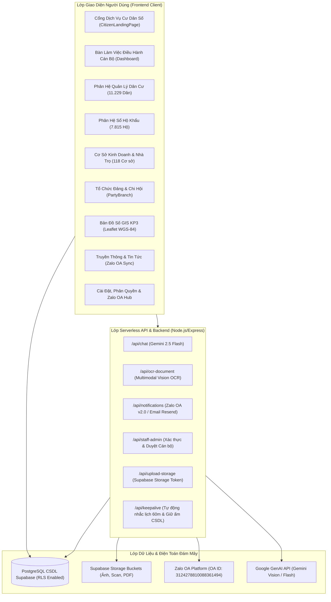
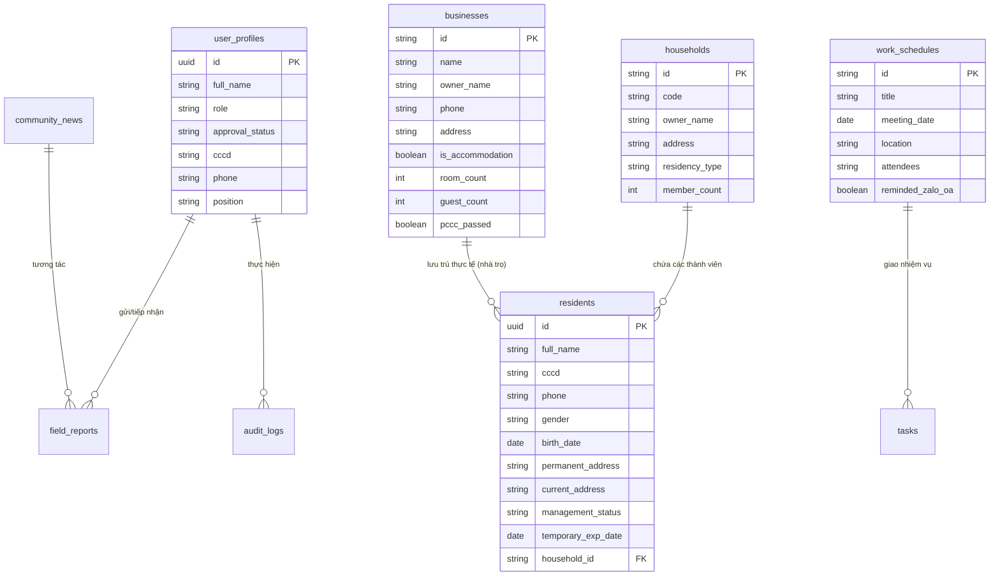

# BẢN ĐỒ KIẾN TRÚC DỰ ÁN (PROJECT ARCHITECTURE MAP)
**Hệ thống Quản lý Thông minh & Cổng Dịch vụ Cư dân số KP3 An Phú**

---

## 1. SƠ ĐỒ TỔNG THỂ HỆ THỐNG (SYSTEM OVERVIEW)

---

## 2. KIẾN TRÚC DỮ LIỆU & QUAN HỆ CƠ SỞ DỮ LIỆU (DATABASE SCHEMA)

---

## 3. CƠ CHẾ ĐIỀU HƯỚNG & PHÂN QUYỀN (ROUTING & ACCESS CONTROL)

1. **Khách / Cư dân (Public / Anonymous):**
   - Truy cập trang chủ Cổng Dịch vụ Cư dân số (`/`).
   - Tra cứu Sổ hộ khẩu điện tử công khai (đã khử PII).
   - Tra cứu Quỹ khu phố công khai, đọc Tin tức cộng đồng (`/news`).
   - Gửi phản ánh hiện trường 1022 và tra cứu tiến độ xử lý.
2. **Cán bộ được phê duyệt (`role: cadre`, `approval_status: approved`):**
   - Đăng nhập qua Supabase Auth.
   - Truy cập toàn bộ Bàn làm việc Điều hành (`/dashboard/*`).
   - Tra cứu và quản lý 11.229 nhân khẩu, 7.815 hộ gia đình, 118 cơ sở kinh doanh.
   - Xem và thao tác Lịch công tác tuần, phân công nhiệm vụ, Quản lý Chi bộ.
3. **Quản trị viên tối cao (`role: admin`, `approval_status: approved`):**
   - Duyệt và phân quyền tài khoản Cán bộ mới đăng ký.
   - Quản trị cấu hình Zalo OA Hub, phát thông báo khẩn cấp toàn khu phố.
   - Kiểm tra nhật ký biến động hệ thống (`audit_logs`).
