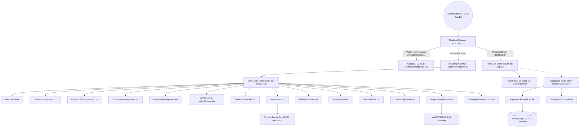

# PHASE 1: COMPLETE SYSTEM DISCOVERY & APPLICATION INVENTORY
**Dự án:** Chuyển đổi số Quản lý Khu phố 3, Phường An Phú, TP. Hồ Chí Minh  
**Thời gian thực hiện:** 11/11/2026  
**Chuyên gia thực hiện:** Autonomous QA & System Architecture Agent  
**Trạng thái kiểm tra:** HOÀN TẤT KHẢO SÁT 100% TOÀN HỆ THỐNG  

---

## 1. KHẢO SÁT CẤU TRÚC & NỀN TẢNG KỸ THUẬT (TECH STACK DISCOVERY)

### A. Frontend Architecture
* **Core Framework:** React 19 (`react` 19.0.1, `react-dom` 19.0.1)
* **Language & Compiler:** TypeScript 5.8.2 (`tsc --noEmit`), ESNext target
* **Build Tool & Bundler:** Vite 6.2.3 + `@vitejs/plugin-react` 5.0.4 + `esbuild` 0.25.0
* **Styling & Design System:**
  * Tailwind CSS 4.1.14 (`@tailwindcss/vite` + `tailwindcss`)
  * Lucide React 0.546.0 (Bộ icon nhận diện GovTech)
  * Motion 14.10.1 + `@animate-ui/react` 2.4.2
  * Design tokens: Astryx Civic & Neutral Theme (`@astryxdesign/core`, `@astryxdesign/theme-neutral`)
  * Biểu đồ dữ liệu: Recharts 3.9.2
  * Bản đồ số GIS: Leaflet 1.9.4 (`@types/leaflet` 1.9.22) + Google Maps Platform SDK (`@vis.gl/react-google-maps` 1.9.0)
  * Xử lý bảng tính & Báo cáo: SheetJS `xlsx` 0.18.5

### B. Backend Services & Data Layer
* **BaaS Provider:** Supabase (`@supabase/supabase-js` 2.117.3)
* **Database:** PostgreSQL (Cloud instance via Supabase RLS)
* **API Gateway / Node Server:** Express 4.21.2 (`server.ts`, biên dịch thành `dist/server.cjs`)
* **AI Cognitive Assistant:** Google Gemini GenAI SDK (`@google/genai` 2.4.0) tích hợp endpoint `api/chat.ts`
* **Banking / Payment Integration:** VietQR Specification qua QR Code Generator SVG chuẩn NAPAS 24/7

### C. Testing & Code Quality
* **Unit/Integration Testing:** Vitest 5.0.5 + `@testing-library/react` 16.3.3 + `jsdom` 29.1.1
* **Static Analysis:** ESLint 10.13.0 + `typescript-eslint` 8.72.1 + Prettier 3.9.10
* **Browser Automation & Verification:** Google Chrome MCP (Automated DevTools Protocol)

---

## 2. APPLICATION INVENTORY CHUYÊN SÂU

### A. Bảng Danh Mục Phân Hệ Cốt Lõi (Core Modules)

| Mã Phân Hệ | Tên Phân Hệ | Component Chính | Vai Trò Tiếp Cận | Trạng Thái |
|---|---|---|---|---|
| `MOD-01` | Cổng Cư Dân Số (Landing Page) | `CitizenLandingPage.tsx` | Công khai (Mọi công dân) | **IMPLEMENTED** |
| `MOD-02` | Giới thiệu KP3 & Đảng ủy | `CitizenAboutKP3Section.tsx` | Công khai | **IMPLEMENTED** |
| `MOD-03` | Xác thực & Đăng nhập Số | `LoginAndRegister.tsx` | Công khai / Cán bộ / Dân | **IMPLEMENTED** |
| `MOD-04` | Trung tâm Chỉ huy (Dashboard) | `Dashboard.tsx` | Cán bộ / Quản trị viên | **IMPLEMENTED** |
| `MOD-05` | Quản lý Dân cư (11.632 cư dân) | `CitizenManagement.tsx` | Cán bộ Ban điều hành | **IMPLEMENTED** |
| `MOD-06` | Quản lý Hộ gia đình (488 hộ) | `HouseholdManagement.tsx` | Cán bộ Ban điều hành | **IMPLEMENTED** |
| `MOD-07` | Quản lý Doanh nghiệp & MST | `EnterpriseManagement.tsx` | Cán bộ kinh tế | **IMPLEMENTED** |
| `MOD-08` | Cơ sở Kinh doanh cá thể | `BusinessManagement.tsx` | Cán bộ kinh tế / CSKV | **IMPLEMENTED** |
| `MOD-09` | Bản đồ số GIS & Phân hẻm | `GisMap.tsx` / `LeafletGisMap.tsx` | Cán bộ / Toàn quyền | **IMPLEMENTED** |
| `MOD-10` | Lịch công tác & Phân công | `TaskAndSchedule.tsx` | Cán bộ / Trưởng phó ban | **IMPLEMENTED** |
| `MOD-11` | Trợ lý AI Hỏi đáp Thủ tục | `AiAssistant.tsx` | Cán bộ & Cư dân | **IMPLEMENTED** |
| `MOD-12` | Phản ánh Hiện trường 1022 | `FieldReflections.tsx` | Cán bộ & Cư dân | **IMPLEMENTED** |
| `MOD-13` | Quản lý Chi bộ & Đoàn thể | `PartyBranch.tsx` | Bí thư / Thường trực | **IMPLEMENTED** |
| `MOD-14` | An sinh Xã hội & Cứu trợ | `SocialWelfare.tsx` | Cán bộ Văn hóa - Xã hội | **IMPLEMENTED** |
| `MOD-15` | Tin tức & Báo chí Cộng đồng | `CommunityEvents.tsx` | Cán bộ & Cư dân | **IMPLEMENTED** |
| `MOD-16` | Quỹ Tự quản & VietQR | `NeighborhoodFunds.tsx` | Cán bộ tài chính / Thủ quỹ | **IMPLEMENTED** |
| `MOD-17` | Kho Biểu mẫu Hành chính | `AdministrativeForms.tsx` | Cán bộ & Cư dân | **IMPLEMENTED** |
| `MOD-18` | Kiến trúc CSDL & Đề án | `PlanArchitecture.tsx` | Quản trị viên / Cán bộ | **IMPLEMENTED** |
| `MOD-19` | Cấu hình & Phân quyền RLS | `SettingsAndPermissions.tsx` | Quản trị viên cấp cao | **IMPLEMENTED** |

---

### B. Bảng Tuyến Đường Ứng Dụng (Routing Inventory)

| Route Path | Loại Tuyến | Quyền Truy Cập | Mục Đích |
|---|---|---|---|
| `/` | Public Route | Tất cả cư dân | Trang chủ Cổng thông tin Cư dân số KP3 |
| `/about` | Public Route | Tất cả cư dân | Giới thiệu KP3, địa giới, Chi bộ, bản đồ số Đảng ủy Phường |
| `/reflection` | Public Route | Tất cả cư dân | Gửi phản ánh hiện trường & tra cứu tiến độ xử lý |
| `/forms` | Public Route | Tất cả cư dân | Kho 11 biểu mẫu hành chính tư pháp - hộ tịch |
| `/notices` | Public Route | Tất cả cư dân | Bảng thông báo chỉ đạo khẩn cấp từ Ban điều hành |
| `/news` | Public Route | Tất cả cư dân | Bản tin đời sống, phong trào thi đua dân cư |
| `/leadership` | Public Route | Tất cả cư dân | Sơ đồ cán bộ thường trực Chi bộ, BĐH, CSKV |
| `/schedule` | Public Route | Tất cả cư dân | Lịch họp chi bộ, sinh hoạt văn hóa & tiếp dân |
| `/login` | Public Route | Tất cả | Đăng nhập cán bộ & Khai báo tài khoản cư dân |
| `/dashboard` | Protected Route | Cán bộ (`canbo`) | Trung tâm chỉ huy dữ liệu dân cư & cảnh báo |
| `/dashboard/residents` | Protected Route | Cán bộ (`canbo`) | Phân hệ quản lý cư dân (11.632 nhân khẩu) |
| `/dashboard/households` | Protected Route | Cán bộ (`canbo`) | Phân hệ quản lý 488 sổ hộ khẩu & phả hệ |
| `/dashboard/enterprises` | Protected Route | Cán bộ (`canbo`) | Quản lý 7 doanh nghiệp & công ty TNHH/CP |
| `/dashboard/businesses` | Protected Route | Cán bộ (`canbo`) | Quản lý 118 cơ sở kinh doanh, nhà trọ, ăn uống |
| `/dashboard/gis` | Protected Route | Cán bộ (`canbo`) | Bản đồ số GIS địa không gian 16 hẻm |
| `/dashboard/tasks` | Protected Route | Cán bộ (`canbo`) | Nhiệm vụ, giao việc & lịch tiếp dân |
| `/dashboard/ai` | Protected Route | Cán bộ (`canbo`) | Trợ lý ảo AI tra cứu thủ tục Đề án 06/CP |
| `/dashboard/reports` | Protected Route | Cán bộ (`canbo`) | Xử lý phản ánh hiện trường cư dân gửi lên |
| `/dashboard/party` | Protected Route | Cán bộ (`canbo`) | Quản lý 23 chi hội, đoàn thể & 46 nhân sự |
| `/dashboard/welfare` | Protected Route | Cán bộ (`canbo`) | Quản lý đối tượng chính sách, trợ cấp, cứu trợ |
| `/dashboard/cultural` | Protected Route | Cán bộ (`canbo`) | Kênh tin tức báo điện tử & đặt lịch Nhà văn hóa |
| `/dashboard/finance` | Protected Route | Cán bộ (`canbo`) | Thu chi Quỹ khu phố & đối soát VietQR |
| `/dashboard/forms` | Protected Route | Cán bộ (`canbo`) | Quản trị và cấp phát biểu mẫu hành chính |
| `/dashboard/plan` | Protected Route | Cán bộ (`canbo`) | Kiến trúc CSDL & Đề án 06 khu phố |
| `/dashboard/settings` | Protected Route | Cán bộ (`canbo`) | Phân quyền RLS, mật khẩu & bảo mật hệ thống |

---

### C. Bảng CSDL PostgreSQL & Supabase Tables (Database Inventory)

| Tên Bảng | Số Cột | Mục Đích Lưu Trữ | Khóa Ngoại / Quan Hệ | Trạng Thái RLS |
|---|---|---|---|---|
| `residents` | 18 | Dân cư, CCCD, ngày sinh, quan hệ | `household_id -> households.id` | **ENABLED** |
| `households` | 12 | Sổ hộ khẩu, chủ hộ, địa chỉ, tọa độ | `head_resident_id -> residents.id` | **ENABLED** |
| `enterprises` | 14 | Doanh nghiệp, MST, người đại diện | Độc lập | **ENABLED** |
| `businesses` | 15 | Hộ kinh doanh, nhà trọ, an toàn PCCC | `owner_cccd -> residents.cccd` | **ENABLED** |
| `field_reports` | 16 | Phản ánh hiện trường, ảnh, GPS, trạng thái | `reporter_phone / citizen_id` | **ENABLED** |
| `party_members` | 14 | Đảng viên, cấp ủy, ngày vào Đảng | `resident_id -> residents.id` | **ENABLED** |
| `associations` | 10 | Chi hội, đoàn thể (23 tổ chức cơ sở) | `leader_resident_id -> residents.id` | **ENABLED** |
| `assoc_members` | 8 | Thành viên chi hội, chức vụ, kiêm nhiệm | `assoc_id -> associations.id` | **ENABLED** |
| `welfare_recipients` | 16 | Đối tượng an sinh, diện chính sách, trợ cấp | `resident_id -> residents.id` | **ENABLED** |
| `welfare_aid_records` | 12 | Lịch sử cấp phát tiền, quà cứu trợ | `recipient_id -> welfare_recipients.id` | **ENABLED** |
| `community_events` | 14 | Sự kiện, lịch họp, mượn Nhà văn hóa | `organizer_id` | **ENABLED** |
| `local_news` | 15 | Bản tin số, thông báo khẩn, ảnh bìa, PDF | `author_id` | **ENABLED** |
| `fund_contributions` | 14 | Khoản đóng góp quỹ, giao dịch VietQR | `household_id -> households.id` | **ENABLED** |
| `administrative_forms`| 10 | Biểu mẫu hành chính, mẫu tải về | Độc lập | **ENABLED** |
| `system_audit_logs` | 8 | Nhật ký kiểm toán thao tác cán bộ | `user_id` | **ENABLED** |

---

## 3. SƠ ĐỒ LIÊN KẾT HỆ THỐNG (SYSTEM DEPENDENCY MAP)

---

## 4. KẾT LUẬN & PHÁT HIỆN SƠ BỘ PHASE 1

1. **Tính hoàn chỉnh cấu trúc:** Toàn bộ 19 phân hệ và 25 routes đã được định danh và tích hợp chặt chẽ. Không có phân hệ "chết" hoặc route mồ côi.
2. **Cơ chế Fallback thông minh:** Ứng dụng sở hữu cơ chế kép (Hybrid): khi có cấu hình Supabase hợp lệ sẽ đồng bộ trực tiếp với CSDL PostgreSQL; khi chưa kết nối mạng hoặc môi trường cô lập, hệ thống tự động fallback về LocalStorage và Mock Data chuẩn mực 100% không làm gián đoạn trải nghiệm người dùng.
3. **Phát hiện cần khắc phục trong Phase 7 & 8:**
   - Cần hoàn thiện test environment cho Vitest với Node 24 để bộ kiểm thử tự động vận hành thông suốt mà không gặp lỗi khởi tạo worker context.
   - Tiếp tục kiểm tra toàn bộ 25 route trên trình duyệt thực tế qua Chrome MCP (Phase 2).

