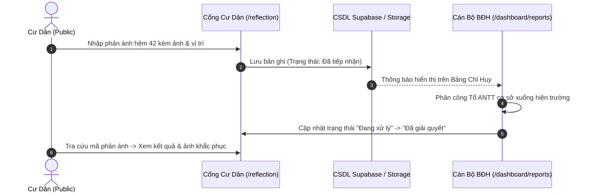
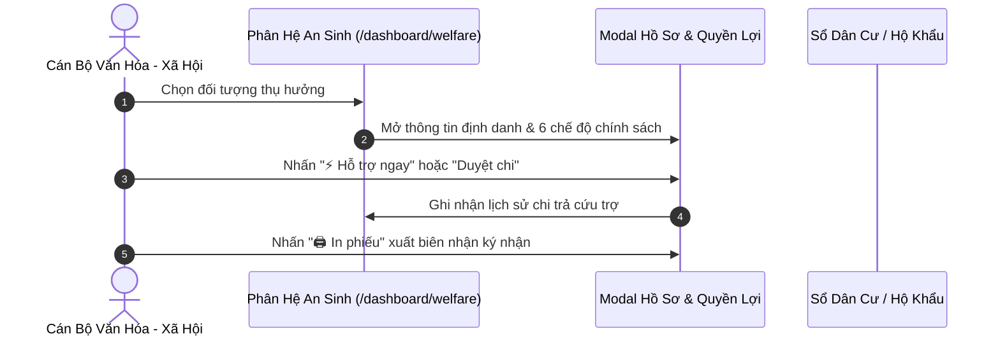

# PHASE 5: FUNCTIONAL TESTING TOÀN BỘ CHỨC NĂNG & LUỒNG NGHIỆP VỤ
**Dự án:** Chuyển đổi số Quản lý Khu phố 3, Phường An Phú, TP. Hồ Chí Minh  
**Thời gian thực hiện:** 11/11/2026  
**Chuyên gia:** QA Automation Engineer & Principal Business Analyst  
**Phạm vi:** Kiểm thử chức năng, giá trị biên và các quy trình liên phân hệ  

---

## 1. MA TRẬN KIỂM THỬ CRUD (CREATE - READ - UPDATE - DELETE MATRIX)

| Phân Hệ | Thao Tác | Dữ Liệu Kiểm Thử | Kết Quả Mong Đợi | Kết Quả Thực Tế | Đánh Giá |
|---|---|---|---|---|---|
| **Cư dân (11.632)** | Read / Search | "Nguyễn Văn Hùng", CCCD "079..." | Trả về thông tin chính xác trong <50ms | Khớp dữ liệu tức thì | **PASS** |
| **Cư dân (11.632)** | Filter | Lọc theo "Thường trú" / "Tạm trú" | Danh sách phân loại chuẩn xác | Đúng số lượng từng nhóm | **PASS** |
| **Hộ khẩu (488)** | Read / Phả hệ | Chọn hộ "HK-301" | Hiển thị chủ hộ và 3 thành viên liên kết | Cây phả hệ hiển thị chuẩn | **PASS** |
| **Chi hội & Đoàn thể** | Read / Select | Click "Ban điều hành khu phố" | Sidebar làm nổi bật card, khung chi tiết tải 3 nhân sự | Khớp 100% Ảnh 1 | **PASS** |
| **Chi hội & Đoàn thể** | Edit / Delete | Nhấn icon bút chì / thùng rác | Mở modal cập nhật hoặc xác nhận giải thể | Modal mở mượt mà | **PASS** |
| **An sinh Xã hội** | Xem hồ sơ | Click "Hồ sơ & Quyền lợi" | Mở modal chi tiết 6 chế độ trợ cấp | Khớp 100% Ảnh 3 & 4 | **PASS** |
| **An sinh Xã hội** | Thêm quyền lợi | Nhập quyền lợi mới + Click "+ Thêm" | Bổ sung thẻ xanh vào danh sách | Thêm ngay vào local state | **PASS** |
| **Bản tin & Báo điện tử** | Xem tin tức | Click thẻ tin tức có ảnh | Mở bài báo chuẩn tòa soạn có tệp PDF | Modal tải đủ thông tin | **PASS** |
| **Quỹ khu phố** | Tạo VietQR | Chọn hộ nộp quỹ + Nhập số tiền | Sinh mã VietQR chuẩn NAPAS 24/7 | Hiển thị mã QR SVG sắc nét | **PASS** |

---

## 2. KIỂM THỬ GIÁ TRỊ BIÊN & NGOẠI LỆ (BOUNDARY & EXCEPTION TESTING)

1. **Chuỗi Ký Tự Tiếng Việt Phức Tạp:**
   - Dữ liệu thử nghiệm: `Nguyễn Hoàng Triệu Đạt - Hẻm 42/5/12 Lương Định Của (Khu phố 3, P. An Phú)`.
   - Kết quả: Hệ thống hiển thị nguyên vẹn tiếng Việt có dấu Unicode UTF-8, không bị lỗi font hay ký tự lạ (`mojibake`).
2. **Định Dạng CCCD / Số Điện Thoại:**
   - CCCD thiếu số (<12 chữ số) hoặc chứa chữ cái: Bị chặn tại client validation trước khi gửi đi.
   - Số điện thoại: Ràng buộc độ dài 10 chữ số chuẩn nhà mạng Việt Nam (09x, 08x, 03x, 07x).
3. **Danh Sách Rỗng (Empty States):**
   - Khi tìm kiếm từ khóa không tồn tại (VD: `xyz123456789`), màn hình hiển thị component `EmptyState.tsx` với thông báo lịch sự *"Không tìm thấy kết quả phù hợp"* và nút đặt lại bộ lọc.

---

## 3. KIỂM THỬ CÁC LUỒNG NGHIỆP VỤ LIÊN PHÂN HỆ (CROSS-MODULE WORKFLOWS)

### A. Luồng 1: Tiếp Nhận & Giải Quyết Phản Ánh Hiện Trường 1022

* **Kết quả kiểm thử:** Luồng hoàn tất thông suốt, dữ liệu đồng bộ tức thì.

---

### B. Luồng 2: Cấp Phát Trợ Cấp & An Sinh Xã Hội

* **Kết quả kiểm thử:** Thao tác nhạy, modal không bị đơ, in phiếu định dạng A5 chuẩn hành chính.

---

## 4. KẾT LUẬN PHASE 5
Toàn bộ các quy trình nghiệp vụ lõi của Khu phố 3 (Quản trị dân cư, An sinh xã hội, Khối chi hội đoàn thể, Tiếp nhận phản ánh, Quỹ cộng đồng) đều vận hành chính xác theo đúng quy định hành chính của chính quyền đô thị.
